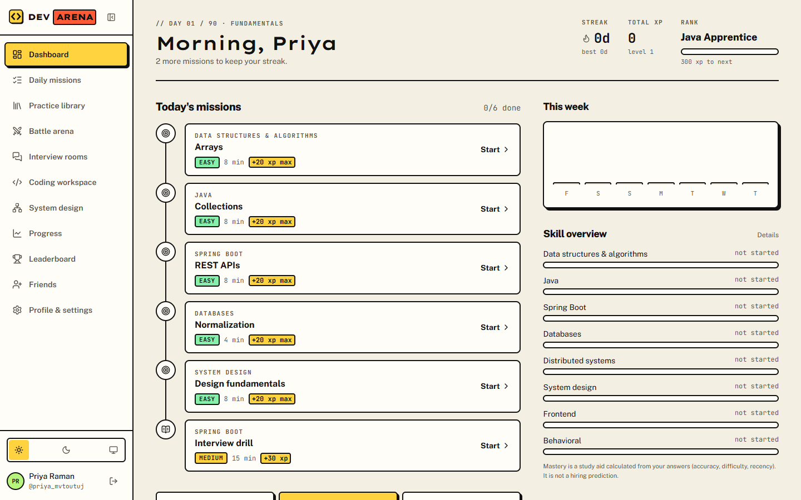
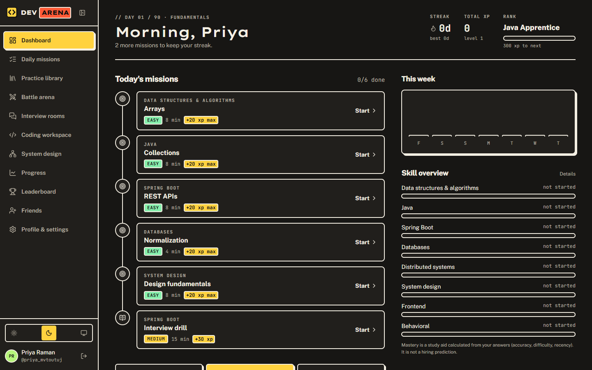
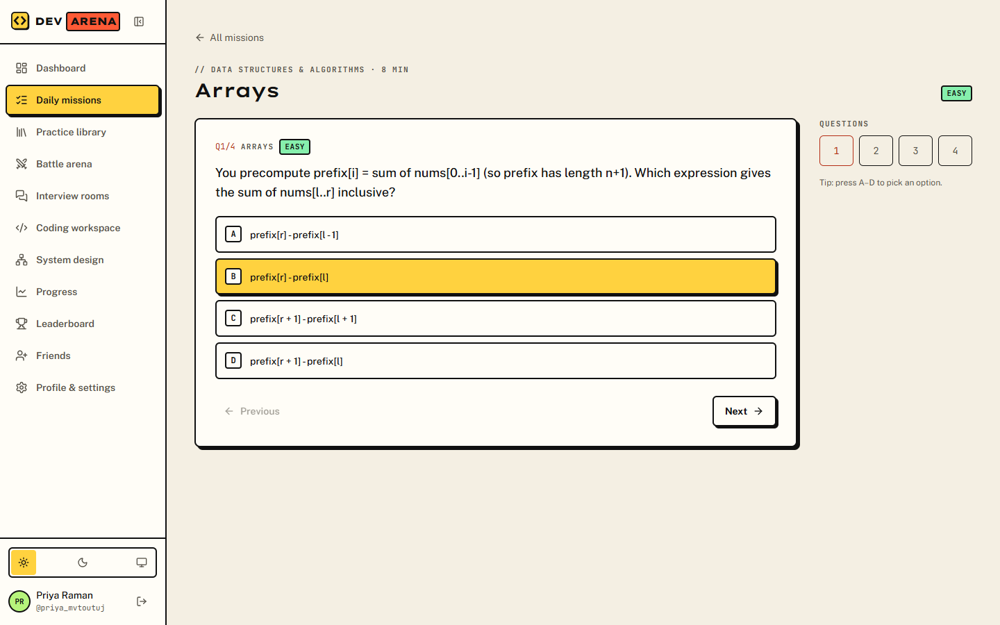
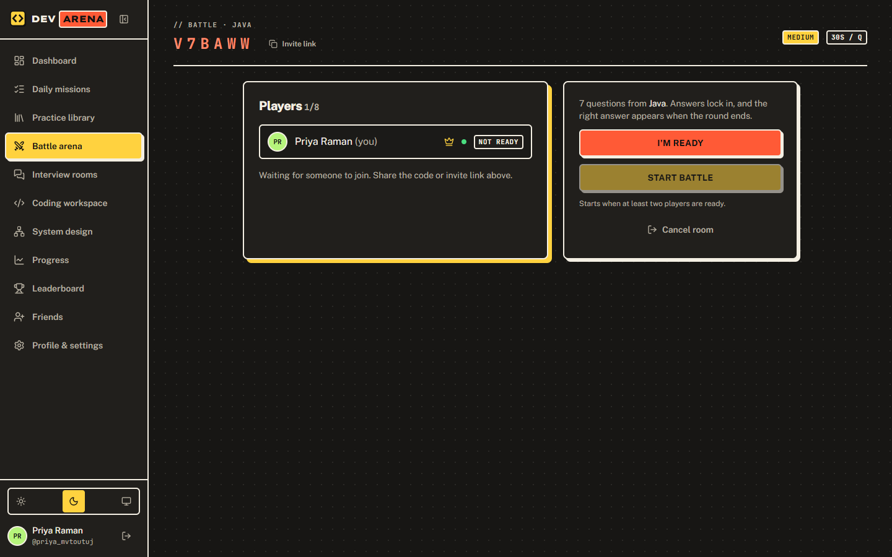
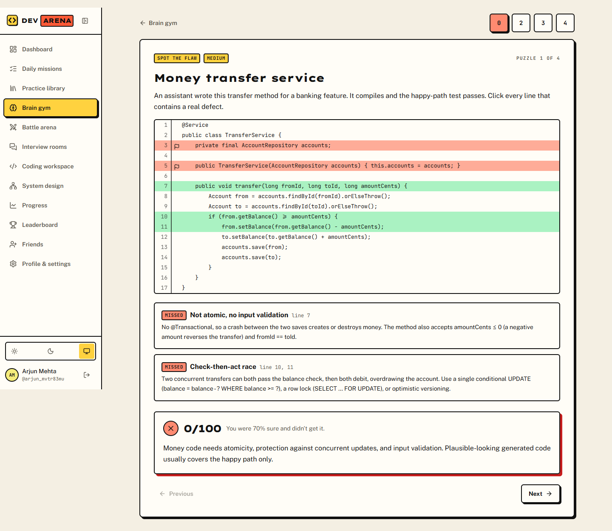
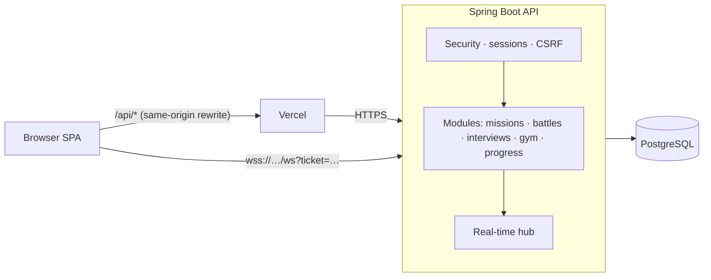

<div align="center">

# DevArena

**Code. Compete. Interview. Improve.**

A multiplayer interview-preparation platform for software engineers who study together:
daily missions on a 90-day roadmap, real-time quiz battles, structured peer interviews, and a
judgment trainer built for engineering in the AI era.




</div>

---

## Contents

- [Why DevArena](#why-devarena)
- [Features](#features)
- [Screenshots](#screenshots)
- [Tech stack](#tech-stack)
- [Architecture](#architecture)
- [Getting started](#getting-started)
- [Testing](#testing)
- [Deployment](#deployment)
- [Project structure](#project-structure)
- [Security](#security)
- [Roadmap](#roadmap)
- [License](#license)

## Why DevArena

Most interview prep is solitary, repetitive and measured only by "did I get it right".
DevArena is built around the things that actually move engineers forward:

- **Consistency.** A daily plan sized to your available time, weighted toward your weak areas.
- **Pressure and accountability.** Live battles and mock interviews with a friend, not just flashcards.
- **Judgment.** Estimation, debugging from evidence, reviewing generated code and design trade-offs,
  each scored deterministically and paired with confidence **calibration**.

Everything runs on curated content and transparent, rule-based scoring. **No paid AI APIs and no API keys**:
every score can be explained, and every piece of feedback comes from a person or a written guide.

## Features

### Learn
| | |
| --- | --- |
| **Daily missions** | A 90-day roadmap in three phases (fundamentals → advanced → interview-ready). A deterministic planner picks each day's missions from your roadmap day, time budget, topic mastery and recent mistakes. XP is awarded once per mission. |
| **Practice library** | 150+ multiple-choice questions across 47 topics (DSA, Java, Spring, databases, distributed systems, system design, AI-engineering concepts), each with a written explanation. Filters, search, bookmarks and a "my mistakes" view. |
| **Coding workspace** | Monaco editor, draft recovery, submission history and reference approaches that unlock after you submit. |
| **System design workspace** | A keyboard-accessible box-and-arrow editor with notes, plus a discussion guide revealed after you submit. |

### Compete
| | |
| --- | --- |
| **Battle arena** | Real-time quiz battles over WebSockets. Lobby, ready-up, server-side timers, 100 points per correct answer plus up to 25 for speed, answers revealed only when the round closes, and battles that survive a server restart. |
| **Leaderboards** | Weekly, monthly and all-time rankings for XP, wins, interviews and coding practice, among friends or everyone. |
| **XP, levels, streaks, achievements** | Streaks follow your own time zone and handle daylight-saving changes correctly. |

### Interview
| | |
| --- | --- |
| **Peer interview rooms** | Nine interview types. The interviewer sees answer guides, follow-ups, common mistakes and a rubric; the candidate never does. This is enforced by the API, not hidden with CSS. |
| **Live coding** | The candidate's editor streams to the interviewer's read-only view using versioned incremental updates. |
| **Structured feedback** | A five-criterion rubric with a fixed weighted score, private interviewer notes, a report for both people, and a one-click rematch with roles swapped. |

### Think: Brain Gym
| | |
| --- | --- |
| **Estimation sprint** | Size systems in your head: give a best guess and an honest range, scored in orders of magnitude. |
| **Incident detective** | Find the root cause of a production incident. Every clue costs points, so you learn when the evidence is enough. |
| **Spot the flaw** | Review plausible generated code and flag the lines that will fail in production. False alarms cost points. |
| **Trade-off arena** | Choose an architecture under real constraints, with partial credit for defensible options, and name the risk you're accepting. |
| **Calibration** | Every answer carries a confidence level. A calibration chart shows whether your "90% sure" is right 90% of the time. |

Plus **friends**, **progress analytics** (activity heatmap, topic accuracy, difficulty trends, interview score
trends), a question **admin** workflow, and a **light/dark theme**.

## Screenshots

<table>
  <tr>
    <td></td>
    <td></td>
  </tr>
  <tr>
    <td align="center"><sub>Dashboard, dark theme</sub></td>
    <td align="center"><sub>Daily mission</sub></td>
  </tr>
  <tr>
    <td></td>
    <td></td>
  </tr>
  <tr>
    <td align="center"><sub>Battle lobby</sub></td>
    <td align="center"><sub>Brain Gym: "Spot the flaw" verdict</sub></td>
  </tr>
</table>

## Tech stack

| Layer | Technology |
| --- | --- |
| Frontend | React 19, TypeScript, Vite, Tailwind CSS v4, TanStack Query, React Router, React Hook Form + Zod, Monaco Editor, Recharts, Radix UI |
| Backend | Java 21, Spring Boot 4.1 (Web MVC, Security, Data JPA, WebSocket, Validation, Actuator), Spring Session JDBC, Flyway |
| Database | PostgreSQL |
| Testing | JUnit 5, embedded PostgreSQL (no Docker), Vitest, Testing Library, Playwright |
| Deployment | Vercel (frontend), Render via Docker (backend), Neon or any PostgreSQL host |

## Architecture

A **modular monolith**: one Spring Boot service and one single-page app. Each module (auth, missions, battles,
interviews, gym, …) owns its controllers, services and tables.



Key decisions:

- **Server-authoritative multiplayer.** Battle timers, scoring and answer validation all happen on the server, under a per-battle lock and inside database transactions.
- **Database-enforced integrity.** Unique constraints make duplicate XP, duplicate answers and double mission completions impossible, even under concurrent requests.
- **Session cookies, not tokens in JavaScript.** HttpOnly session cookies stay first-party through a same-origin proxy. WebSockets authenticate with short-lived, single-use tickets.
- **Deterministic "intelligence".** The mission planner, mastery model, interview scoring and Brain Gym scoring are pure, documented and unit-tested functions.

Read more in [docs/architecture.md](docs/architecture.md) and [docs/realtime-protocol.md](docs/realtime-protocol.md).

## Getting started

### Prerequisites

- Java 21 and Maven 3.9+
- Node.js 20+

No database installation or Docker is required for local development.

### 1. Start the backend

```bash
cd backend
mvn -q test-compile exec:java
```

This starts an embedded PostgreSQL (data is kept in `.data/pg`), runs the Flyway migrations, loads the
content bank and serves the API on **http://localhost:8080**. The health check is `/actuator/health`.

<details>
<summary>Use your own PostgreSQL instead</summary>

```bash
psql -U postgres -h localhost \
  -c "CREATE ROLE devarena LOGIN PASSWORD 'devarena_local'" \
  -c "CREATE DATABASE devarena OWNER devarena"

cd backend
DATABASE_PASSWORD=devarena_local mvn spring-boot:run          # bash
$env:DATABASE_PASSWORD='devarena_local'; mvn spring-boot:run  # PowerShell
```
</details>

### 2. Start the frontend

```bash
cd frontend
npm install
npm run dev
```

Open **http://localhost:5173** and create an account. Vite proxies `/api` and `/ws` to the backend.

### Admin access (optional)

```sql
UPDATE users SET role = 'ADMIN' WHERE username = 'your_username';
```

Sign out and back in to see **Question admin** in the sidebar.

## Testing

```bash
cd backend  && mvn test        # 36 unit + integration tests against real PostgreSQL
cd frontend && npm test        # 12 component, form and parser tests
cd frontend && npm run e2e     # Playwright end-to-end flows (backend must be running)
```

Integration tests drive the real HTTP API with cookies and CSRF tokens, the way a browser does. They cover:
- authorization
- concurrency (simultaneous duplicate submissions)
- secrecy (no answers or guides before they should appear)
- the full battle and interview lifecycles

The end-to-end suite plays the complete critical path with two real browser sessions: register → mission →
battle → interview → feedback → progress. It also plays a full Brain Gym daily run. Details are in
[docs/testing.md](docs/testing.md).

## Deployment

| Component | Platform | Config |
| --- | --- | --- |
| Frontend | Vercel | [`frontend/vercel.json`](frontend/vercel.json): SPA fallback, `/api` rewrite, security headers |
| Backend | Render (Docker) | [`backend/Dockerfile`](backend/Dockerfile), [`render.yaml`](render.yaml) |
| Database | Neon / any PostgreSQL | `DATABASE_URL` with `sslmode=require` |

Everything is designed to run on free tiers. The step-by-step guide is in [docs/deployment.md](docs/deployment.md), and
every variable is listed in [docs/environment.md](docs/environment.md).

## Project structure

```
DevArena/
├── backend/                 Spring Boot API
│   └── src/main/
│       ├── java/com/devarena/   auth, users, missions, questions, battles, interviews,
│       │                        coding, design, gym, progress, gamification, realtime, …
│       └── resources/
│           ├── db/migration/    Flyway migrations
│           └── content/         curated questions, interview guides, puzzles (JSON)
├── frontend/                React + Vite SPA
│   ├── src/                 pages, components, API and real-time clients
│   └── e2e/                 Playwright tests
├── design-system/           visual language and tokens
├── docs/                    architecture, API, protocol, database, deployment, testing
└── render.yaml              Render blueprint
```

## Security

- bcrypt password hashing, login throttling and generic authentication errors
- HttpOnly, Secure, SameSite session cookies stored server-side; CSRF protection on every state-changing request
- an explicit CORS and WebSocket origin allowlist
- authorization checks on every room-specific API call and WebSocket subscription; other users' resources return `404`
- role separation in interviews enforced by the API's response types
- no user-submitted code is ever executed on the server
- no secrets in the repository; all configuration comes from environment variables

See [docs/architecture.md](docs/architecture.md#authentication-and-the-threat-model) for the threat model.

## Roadmap

- Sandboxed code execution for automated test runs (the `CodeExecutionService` interface is in place)
- Live coding battles and timed Brain Gym duels
- An authoring UI for Brain Gym puzzles
- Spaced-repetition scheduling
- Horizontal scaling with shared pub/sub (today the app targets a single instance)

The full checklist is in [TASKS.md](TASKS.md).

## Known limitations

- Submitted code is reviewed by people; there is no automated execution yet.
- Real-time state (timers, sockets) is in memory, so run **one** backend instance. Battles resume from the database after a restart.
- Free-tier hosts sleep when idle, so the first request may take up to a minute. The UI shows a "waking up" state and retries.
- Mastery and calibration scores are study aids, not validated hiring predictors.

## License

Licensed under the [Apache License 2.0](LICENSE).
